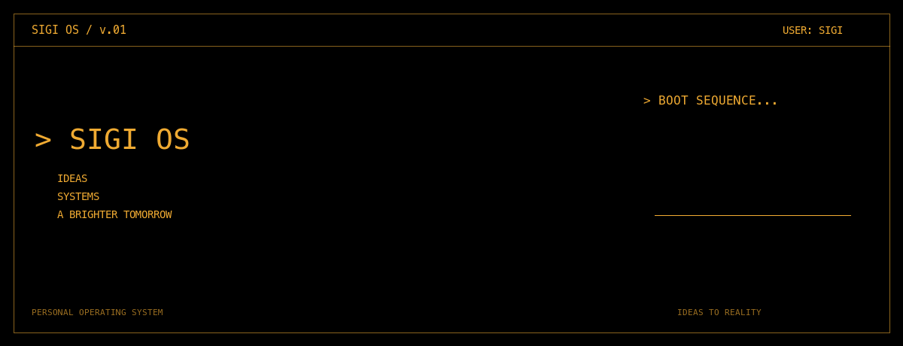
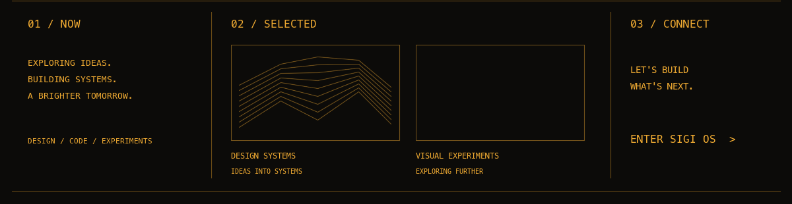

 

<a href="https://itssigi.github.io/itsSIGI/">PLAY / REPAIR THE CORE ↗</a> · <a href="https://github.com/itsSIGI/sigi-design-skills">Design Skills</a> · <a href="https://github.com/itsSIGI/agentic-design-system-skill">Design System</a> · <a href="https://github.com/itsSIGI/aurora-html-ppt">Aurora PPT</a>

Text mode / accessible project directory

### 01 / NOW
Exploring ideas. Building systems. Making things real. Design, code, and whatever comes next.

### 02 / SELECTED
- [Sigi Design Skills](https://github.com/itsSIGI/sigi-design-skills): AI-powered design workflow.
- [Agentic Design System](https://github.com/itsSIGI/agentic-design-system-skill): Design-system foundations.
- [Aurora HTML PPT](https://github.com/itsSIGI/aurora-html-ppt): Aurora-style presentation toolkit.

### 03 / CONNECT
[Play the 8-bit core repair game](https://itssigi.github.io/itsSIGI/) or [explore my repositories](https://github.com/itsSIGI?tab=repositories).

