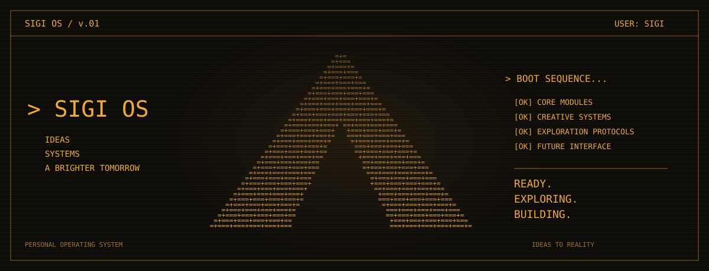

  

| `01 / NOW` | `02 / SELECTED` | `03 / CONNECT` |
| :--- | :--- | :--- |
| Exploring ideas. Building systems. Making things real.  Design, code, and whatever comes next. | [Sigi Design Skills](https://github.com/itsSIGI/sigi-design-skills) AI-powered design workflow.  [Agentic Design System](https://github.com/itsSIGI/agentic-design-system-skill) Design-system foundations.  [Aurora HTML PPT](https://github.com/itsSIGI/aurora-html-ppt) Aurora-style presentation toolkit. | Let's build what's next.  [Explore my repositories →](https://github.com/itsSIGI?tab=repositories) |

---

`sigi@workspace:~$` **Always a work in progress.**
